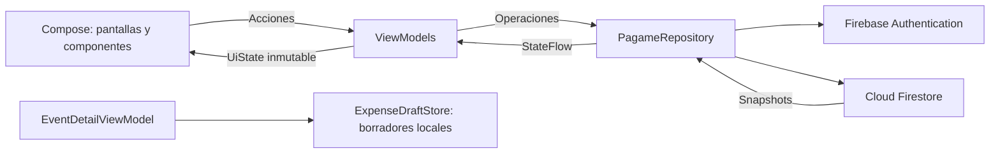

# Pagame

Aplicación Android para dividir gastos entre amigos en eventos. Permite registrar quién pagó, repartir los importes entre participantes y confirmar los pagos para mantener balances compartidos.

Está desarrollada con Kotlin y Jetpack Compose. Utiliza Firebase Authentication y Cloud Firestore directamente, con una arquitectura pensada para Firebase Spark. No utiliza Room ni Cloud Functions.

## Funciones

### Cuenta y preferencias

- Registro e inicio de sesión con correo y contraseña, sesión persistente y recuperación de contraseña por correo.
- Completar el perfil si la cuenta de Authentication existe y falta su perfil de Firestore.
- Editar nombre y color del perfil, copiar o compartir el código de amigo.
- Tema claro, oscuro o del sistema.
- Monedas GTQ, USD y EUR. La preferencia se aplica a eventos nuevos; no convierte los importes existentes.
- Cierre de sesión y eliminación de cuenta con comprobación de eventos asociados y requisitos propios de Firebase Authentication.

### Amigos

- Búsqueda de usuarios reales por código PG de cuatro dígitos.
- Solicitudes con envío, aceptación, rechazo y cancelación.
- Amistad recíproca al aceptar y eliminación de la relación desde cualquiera de las dos cuentas.
- La eliminación de una amistad conserva los eventos, gastos y pagos compartidos.
- Regularización de amistades antiguas unilaterales mediante solicitud explícita.

### Eventos y gastos

- Creación de eventos con amigos seleccionados, identificación del creador y eventos recientes primero.
- Agregar amigos y responder solicitudes desde la creación del evento sin perder el formulario.
- Cualquier participante del evento puede agregar gastos.
- Gastos con concepto, monto, pagador y participantes; se muestran el autor del registro y quien pagó como datos distintos.
- Edición y eliminación de gastos por su autor o por el organizador.
- Edición de participantes por el organizador, con resumen de cambios y bloqueo de personas con gastos o pagos asociados.
- Eliminación de eventos vacíos por su organizador.
- Iniciales del nombre o concepto en las tarjetas. No hay selección ni validación de emojis.
- Borradores locales de gastos nuevos durante 30 minutos, separados por usuario y evento. Se pueden continuar o descartar; no se comparten ni se publican como gastos hasta guardarlos.

### Balances y pagos

- Cálculos en centavos enteros y reparto determinista de los centavos restantes.
- Sugerencias de pago según los saldos del evento.
- El deudor informa que pagó; el receptor confirma o rechaza la recepción.
- El balance cambia al confirmar el receptor. Actualmente se admite un pago pendiente por evento.
- Editar o borrar gastos conserva los pagos pendientes y el historial confirmado.
- La aplicación registra pagos entre personas; no realiza transferencias bancarias.

### Sincronización e interfaz

- Actualizaciones mediante listeners de Firestore y actualización manual al deslizar.
- Estructura Material 3 con TopAppBar y NavigationBar/NavigationBarItem para las pestañas principales.
- Tipografía y colores centralizados en el tema; separaciones y padding con la escala compartida Spacing, en múltiplos de 4 dp.
- Formularios de eventos, gastos y participantes como hojas inferiores.
- Interfaz con soporte de tema y márgenes de las barras del sistema.
- Caché habitual de Firestore para información ya descargada. Las operaciones que usan transacciones necesitan conexión; no existe una cola propia que garantice guardar cualquier acción sin internet.

## Configuración

1. Abrir esta carpeta en Android Studio y sincronizar el proyecto con su Gradle Wrapper.
2. Configurar el SDK de Android en la instalación local. El proyecto declara minSdk 24, compileSdk/targetSdk 37 y criterios de daemon JDK 21; el código Java tiene destino 17.
3. Comprobar que app/google-services.json corresponda al proyecto Firebase y a la aplicación gt.pagame.app.
4. Habilitar Correo electrónico/contraseña en Firebase Authentication.
5. Utilizar la base Cloud Firestore predeterminada y publicar el contenido completo de [firestore.rules](firestore.rules) desde Firestore Database > Reglas.
6. Compilar e instalar la aplicación. No es necesario crear perfiles, códigos, eventos ni saldos manualmente.

Modificar firestore.rules en esta carpeta no publica reglas en Firebase. Publicarlas tampoco actualiza el APK de los teléfonos. No se deben reemplazar por permisos de acceso abierto ni borrar datos para solucionar errores.

La configuración incluye [firebase.json](firebase.json) y [firestore.indexes.json](firestore.indexes.json). El uso de Firebase queda sujeto a las cuotas del proyecto. Node.js y Firebase CLI se utilizan únicamente para las pruebas técnicas opcionales, no para ejecutar la aplicación Android.

Los eventos actuales usan schemaVersion 2. Los documentos de formatos anteriores no se migran automáticamente.

## Estructura

| Ubicación | Contenido |
| --- | --- |
| app/src/main/java/gt/pagame/app/MainActivity.kt | Entrada Android y configuración del tema y barras del sistema. |
| app/src/main/java/gt/pagame/app/ui/navigation | Navegación y contenedor principal. |
| app/src/main/java/gt/pagame/app/ui/screens | Pantallas, ViewModels y estados de interfaz. |
| app/src/main/java/gt/pagame/app/ui/components | Componentes visuales y actualización manual. |
| app/src/main/java/gt/pagame/app/ui/theme | Colores, tipografía y temas. |
| app/src/main/java/gt/pagame/app/data/model | Modelos, validadores de entrada y cálculos de eventos y saldos. |
| app/src/main/java/gt/pagame/app/data/repository | Acceso a Firebase y almacenamiento local de borradores. |
| app/src/test | Pruebas Kotlin. |
| verification | Pruebas locales de reglas y suite para el emulador oficial. |

El flujo habitual es Pantalla → ViewModel → PagameRepository → Firebase. SparkEvents prepara y valida las operaciones de eventos; EventAccounting calcula los valores derivados. Firestore vuelve a comprobar los permisos y la consistencia al guardar el evento junto con sus diez documentos auxiliares ledger.

### Arquitectura MVVM

La UI recolecta el estado mediante `collectAsStateWithLifecycle()`. Los Composables
muestran datos y envían acciones al ViewModel; las operaciones de Firebase se
realizan en el repositorio. La navegación, el portapapeles, el teclado y las
animaciones permanecen en la capa de UI.

- `AppViewModel`: tema, sesión, perfiles públicos para avatares y formulario para completar el perfil; conserva el nombre con SavedStateHandle.
- `FriendRequestsViewModel`: solicitudes recibidas/enviadas, carga, respuesta en proceso, avisos y errores.
- `RefreshViewModel`: actualización desde el servidor y sus estados de progreso y error; el gesto visual recibe estado y callbacks.
- Los ViewModels de Eventos, Amigos, Detalle, Login, Registro y Opciones mantienen las acciones y estados propios de cada pantalla.

Los estados usan propiedades `val` y se exponen con `asStateFlow()`. Las listas
vacías muestran su contenido alternativo; la carga, las operaciones en proceso y
los errores se representan explícitamente. Los datos existentes se mantienen
visibles durante la actualización manual.

No se cargan cuentas, amigos, eventos o gastos de prueba al iniciar. FriendDirectory conserva ejemplos aislados de la ejecución, y los datos de pruebas no se publican automáticamente.

## Seguridad y motivos de rechazo

Las reglas de Firestore autorizan las operaciones en el servidor: sesión autenticada,
preferencias privadas por UID, eventos accesibles a sus participantes, autoría de
gastos, aceptación recíproca de amistad y confirmaciones de pagos por el receptor.
Los perfiles básicos y códigos son consultables individualmente por usuarios
con sesión; no son información privada. Los correos no se guardan en esos perfiles.
Las colecciones no declaradas quedan denegadas por defecto.

No hay una restricción propia de cinco minutos para eliminar o anonimizar una
cuenta. Las reglas siguen exigiendo que el usuario sea el dueño del perfil y que
el perfil esté anonimizado al eliminar preferencias y código. Firebase Authentication
puede exigir autenticación reciente al ejecutar su propia eliminación de usuario;
ese requisito del servicio no se desactiva con reglas de Firestore.
La comprobación de que no quedan eventos asociados está en el cliente; las reglas
no hacen consultas globales para verificarla.

La UI explica los bloqueos de formularios, permisos de edición, retiro de
participantes con gastos/pagos, eliminación de eventos con historial y pagos
pendientes. Los errores de red, sesión, límites de servicio y conflictos muestran
mensajes sin exponer excepciones internas. Un rechazo genérico de Firebase no
permite conocer qué condición exacta de una regla falló.

El manifiesto deshabilita copias de seguridad y tráfico HTTP sin cifrar. Esto no
cifra los borradores locales de SharedPreferences: el cifrado con Keystore sigue
pendiente si se consideran datos sensibles para la entrega. No se activó App Check
ni verificación obligatoria de correo. Las reglas no sustituyen controles contra
abuso ni una auditoría completa de seguridad.

Verificación del 6 de noviembre de 2026: 43 pruebas del intérprete local de reglas
y 34 pruebas Kotlin aprobadas. Todos los Kotlin de producción compilaron con
Compose y dependencias en caché. No se ejecutó el emulador oficial ni se generó
un APK actualizado. Publicar `firestore.rules` requiere una acción aparte; estos
cambios locales no prueban cuáles reglas están desplegadas.

## Límites de la aplicación

- Hasta 30 participantes, 500 gastos y 500 pagos confirmados por evento.
- Hasta 300 amigos por cuenta.
- Gastos entre 0.01 y 100,000.00, con hasta dos decimales. Se acepta punto o coma decimal, sin separadores de miles.
- Nombre de perfil hasta 60 unidades UTF-16; nombre de evento y concepto hasta 100. La función de truncado evita cortar un par sustituto.
- Las restricciones del tamaño de documento y las cuotas de Firestore también se aplican.

## Compilación y pruebas

Desde la raíz, en Windows:

~~~powershell
.\gradlew.bat :app:testDebugUnitTest :app:assembleDebug
~~~

Para las pruebas locales de reglas:

~~~powershell
cd verification
npm test
~~~

Las pruebas locales de reglas no necesitan instalar dependencias. La ejecución con el emulador oficial se explica en [verification/README.md](verification/README.md).

En la revisión del 19 de octubre de 2026 pasaron 27 pruebas Kotlin del modelo y del estado de detalle mediante compilador local/JUnit, y 41 pruebas del intérprete local de reglas. La compilación Android completa se detuvo antes de compilar con Unable to establish loopback connection de Gradle. No se completó la prueba visual en un dispositivo ni la suite del emulador oficial Firestore. Tampoco se confirmó la publicación de las reglas remotas.

Después del ajuste de Material 3 se compilaron todos los archivos Kotlin de producción con el plugin de Compose 2.2.10 y el classpath Android disponible en caché, sin errores. Las 27 pruebas Kotlin también pasaron contra esas clases compiladas, sin extraer el estado de interfaz. Esto valida el código fuente, pero no sustituye el ensamblado del APK con Gradle ni la comprobación visual en Android.

Tras el ajuste MVVM del 26 de octubre de 2026 se compilaron todos los Kotlin de
producción con Compose y las dependencias Android en caché, y pasaron las 27
pruebas existentes contra esas clases. Gradle sigue detenido por la conexión
loopback del entorno. Esta comprobación no genera un APK ni prueba los nuevos
ViewModels con Firebase en un dispositivo.

Antes de distribuir, comprobar con dos cuentas el envío y aceptación de amistad, los eventos compartidos, gastos agregados por distintos miembros, confirmación de pagos, borradores separados por evento y las restricciones de edición y eliminación.

## Contexto del proyecto

[CONTEXTO_CHAT.txt](CONTEXTO_CHAT.txt) conserva las decisiones, el estado de los cambios y los pendientes para retomar el desarrollo. El código de esta carpeta es la fuente de verdad.
